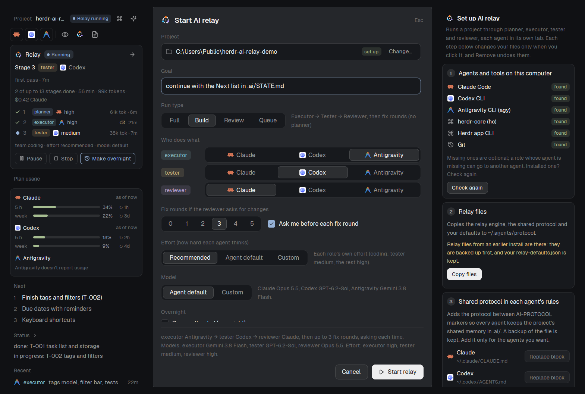
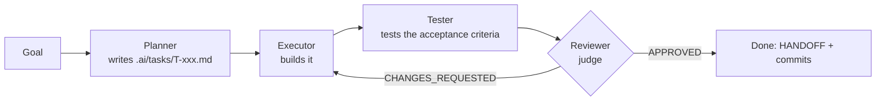

# herdr-ai-relay

**A relay team of AI coding agents inside the Herdr app.** Give it a goal and it runs your project through a
planner, an executor, a tester and a reviewer, one after another, each in its own Herdr tab. Pick which agent
plays each role (Claude Code, Codex or Antigravity) and how hard each one thinks. The reviewer approves the work
or sends it back for a fix round. A panel shows every stage live, with tokens and plan usage. It can also run
unattended overnight on its own git branch. Every agent shares one memory in the project's `.ai/` folder, so any
of them can pick up where another stopped.



> **Windows only for now** (the relay engine is PowerShell). macOS and Linux are on the [roadmap](#roadmap).

## Features

- **Relay roles and teams**: the built-in *coding* team is planner → executor → tester → reviewer. Add your own
  teams (for example outliner → writer → editor) with a job per role and one *judge* that approves or asks for
  changes. Fix rounds repeat until the judge approves or the round limit is reached.
- **Queue mode** for big goals: the planner splits the goal into task files, each naming the agents that suit it
  best (from each agent's *strengths*). You approve the queue, then each task gets its own mini-relay, one at a time.
- **Start it from anywhere**: the *Start AI relay* dialog (Ctrl+Alt+R), `relay` in PowerShell, or type `relay` in
  any agent. That agent asks you everything in one message and starts the relay in its own tab.
- **"me" roles**: when you start from an agent, you can give that agent session a role. The relay hands it the
  task when its turn comes.
- **A live panel**: the project's Next list, status and recent work, plus the relay's stages with agent, model,
  effort, minutes, tokens and cost. It also shows Claude and Codex plan usage (5-hour and weekly) and has Pause,
  Stop and Make overnight buttons.
- **Effort and model per role**: *Recommended*, each agent's default, or your own choice per role. The executor
  always thinks at high effort or above.
- **Overnight mode**: run unattended until a time, for a number of cycles, or until done. It works on its own
  branch, a watchdog handles stalls and usage limits, and a report is waiting in the morning. You can **switch a
  relay that is already running** to overnight, or change its limits mid-night.
- **Stages clean up after themselves**: agents stop the dev servers and test runs they started, and the relay
  stops any they leave behind.
- **Survives Herdr restarts**: the relay waits for the window to come back. If an error ever ends a relay, the
  panel says why.
- **One click to set up, one click to remove**: the panel's setup screen changes each thing only when you click it,
  keeps backups, and *Remove* undoes everything.

## Requirements

- Windows 10 or 11 with Windows PowerShell 5.1 (built in) or PowerShell 7.
- The [Herdr app](https://herdr.dev/download/), which includes herdr-core (`hc`).
- [Git](https://git-scm.com/install/).
- At least one agent CLI, installed and signed in:
  [Claude Code](https://code.claude.com/docs/en/setup) (`claude`),
  [Codex CLI](https://github.com/openai/codex) (`codex`) or
  [Antigravity CLI](https://antigravity.google/download) (`agy`).
  All three give the most choice; a role can go to any agent you have.

## Install

In any Herdr tab, ask your agent:

```
Read ~/.config/herdr-app/AGENTS.md, then add this mod: herdr.dev/mods/farukEncoded/herdr-ai-relay
```

Or point it at GitHub directly. This works even before the herdr.dev gallery lists the mod, and the gallery can
take a while to list a new one:

```
Read ~/.config/herdr-app/AGENTS.md, then add this mod: github.com/farukEncoded/herdr-ai-relay
```

The agent copies the six folders in [`mods/`](mods) into `~/.config/herdr-app/mods/` and merges
[`keys.json`](keys.json) into yours (it asks before replacing a key you already use).

**By hand:** copy each folder in `mods/` to `%USERPROFILE%\.config\herdr-app\mods\`, then add the four keys from
`keys.json` to the `"global"` section of your `keys.json`.

Then open the **AI Relay** panel (it docks on the right; restart Herdr if it doesn't appear) and follow
**Set up AI relay**:

1. **Agents and tools**: shows what is found and links to each official install page. Nothing is downloaded for you.
2. **Relay files**: copies the engine to `~/.agents/protocol`.
3. **Shared protocol**: one button per agent, adding the protocol to `~/.claude/CLAUDE.md`, `~/.codex/AGENTS.md`
   and `~/.gemini/GEMINI.md` (with a backup of each).
4. **The relay command**: adds `relay` to your user PATH.
5. **Herdr + menu**: adds the agents that were found, plus *AI Relay*.

## Quick start

1. Open a Herdr space in your project folder. A new project? Click **Set up protocol** in the panel: Claude adds the
   `.ai/` folder.
2. Press **Ctrl+Alt+R**, write a goal ("a small to-do web app with tags"), and keep the defaults: run type
   **Full**, the coding team, Recommended effort.
3. Click **Start relay**. An *AI Relay* tab opens, then one tab per stage. Watch the panel. **Pause** and **Stop**
   take effect between stages, and you can type into any stage's tab.
4. When the reviewer approves, read `.ai/HANDOFF.md` (Ctrl+Alt+H opens it) and the commits.

Other ways to start: type `relay` in PowerShell inside the project, or type `relay` in Claude Code, Codex or
Antigravity.

| Key | Action |
|---|---|
| Ctrl+Alt+R | Start AI relay |
| Ctrl+Alt+P | Focus the AI Relay panel (then 1/2/3 continue with an agent, R relay, H handoff, V review) |
| Ctrl+Alt+H | Handoff viewer (HANDOFF, STATE, current task, DECISIONS) |
| Ctrl+Alt+A | All AI commands |

## How it works



- `ai-relay.ps1` opens a Herdr tab per stage and starts that stage's agent with its role, the goal and the job.
  It waits until the agent has finished the protocol's end-of-session steps (state, handoff, log, commit) and
  written `.ai/relay/stage-N.done`.
- Each agent reads and writes the project's `.ai/` folder (STATE, HANDOFF, DECISIONS, LOG, tasks), which is the
  shared memory. The shared protocol (`AI-PROTOCOL.md`) tells every agent how.
- The relay writes `.ai/relay/status.json` (stages, tokens, usage, questions). The panel reads it, and the panel's
  Pause, Stop and Make overnight buttons drop control files next to it.
- *Run types*: **Full** (every role), **Build** (no planner), **Review** (the judge alone), **Queue** (plan into
  tasks, approve, a mini-relay per task).

## Configuration

`~/.agents/protocol/relay-defaults.json` (the shipped version is
[`mods/ai-relay-kit/payload/relay-defaults.json`](mods/ai-relay-kit/payload/relay-defaults.json)). Anything you pick
when starting a relay overrides it.

| Key | Default | Meaning |
|---|---|---|
| `team` | `"coding"` | The team used when you don't pick one. |
| `teams` | coding team | Roles in order. Each has `job`, `agent` (`claude`, `codex`, `antigravity`), `effort`, `once` (first pass only), `judge`. Copy `_exampleTeam` here to add a team. |
| `strengths` | per agent | What each agent is good at; the queue planner picks agents per task from these. |
| `maxRounds` | `3` | Fix rounds at most. |
| `askEachRound` | `true` | Ask before each fix round. |
| `timeoutMin` | `120` | Minutes per stage before the relay asks you what to do. |
| `effort` | `"recommended"` | `recommended`, `none` (agent defaults) or `role=level,...` (`low` to `max`). |
| `model` | `"default"` | `default` or `role=name,...` (Claude `fable`/`opus`/`sonnet`/`haiku`, Codex `sol`/`astra`/`terra`/`luna`, Antigravity `flash`/`sonnet`/`opus`/`gpt-oss`). |
| `codexApproveForMe` | `true` | Codex stages start with `--approve-for-me`: Codex keeps its sandbox, and its own automatic reviewer answers its approval requests (such as its git commits), so a stage doesn't stop on a prompt each time. |
| `codexWindowsSandbox` | `"mxc"` | The Windows sandbox Codex stages run in (`-c windows.sandbox=<value>`). `"none"` leaves it to your Codex config. |
| `overnight.skipPermissions` | `true` | Overnight stages start agents with their permission checks off (see Safety). |
| `overnight.until` | `"07:00"` | Overnight: no new task after this time, or `"done"` for no time limit. |
| `overnight.maxCycles` | `3` | Overnight queue: plan-and-run cycles at most, `0` = no limit. |
| `overnight.stallMinutes` | `30` | No progress for this long: nudge the agent, then skip the stage. |
| `overnight.maxStageMinutes` | `180` | A stage is interrupted after this long. |

### Overnight runs

Tick **Run unattended (overnight)** in the dialog, or answer the overnight question in PowerShell or in an
agent's relay setup. It is opt-in per run and never remembered.

- **Run until** a time (`08:00`) or **until done**, and with Queue a number of **cycles** (1, 2, 3, 5, 10 or no limit).
  Whichever comes first ends the night. The night also ends early when the planner finds nothing worthwhile left.
- **Pre-flight first**, while you are still there: the AI Relay tab checks git, the branch name, the limits and
  plan usage. It also checks that Codex trusts the folder, and offers to add the trust entry. Nothing runs until
  you answer `y`.
- Then there are no questions: the queue starts by itself and an unapproved task moves on to the next. A watchdog
  waits out usage limits, nudges stalled stages and skips them if they stay stuck.
- The morning report is `.ai/relay/overnight-report.md`.

**Switch a running relay to overnight** (or change an overnight relay's limits), without restarting it:

- In the panel: **Make overnight** (or **Limits**) on the relay card.
- In PowerShell, in the project: `relay overnight -Until 09:00 -MaxCycles 5`. `-Until done` means no time limit,
  `-MaxCycles 0` means no cycle limit, and leaving a flag out uses its default.
- Or ask any agent: "make the running relay overnight until 9, 5 cycles".

The relay picks this up within seconds, even while it is waiting for an answer. From its next stage on, it works
overnight on a new branch. The agent already running keeps its own mode.

## Safety

- **Overnight mode skips ALL agent permission checks, on purpose**, so nothing waits for approval at night:
  `claude --dangerously-skip-permissions`, `codex --dangerously-bypass-approvals-and-sandbox`,
  `agy --dangerously-skip-permissions`. The agents can then run any command in that project without asking. Use it
  only on a project you would trust them with, in a git repo. It works on its own branch
  (`relay/overnight-<date-time>`), **never pushes**, and leaves your branch as it was. Review and merge in the
  morning. Stop works at any time.
- Normal (daytime) relays use each agent's own permission settings, so approvals still go to you.
- **What setup changes**, only when you click each step:
  - `~/.agents/protocol/`: the relay engine and your defaults.
  - A block between `AI-PROTOCOL:BEGIN/END` markers in `~/.claude/CLAUDE.md`, `~/.codex/AGENTS.md` and
    `~/.gemini/GEMINI.md`, with a `.bak-ai-relay-kit` backup of each file.
  - One entry in your user PATH.
  - Entries in Herdr's `programs.json`. Entries you already have are kept.

  Each change is recorded in `~/.agents/protocol/.ai-relay-kit.json`.
- **Remove** (setup screen, click twice) undoes those changes. A file still as setup left it gets its backup back,
  or is deleted if setup created it. A file you edited since keeps your edits and only loses the protocol block.
  An earlier relay install found during setup is backed up first, and your `relay-defaults.json` is never
  overwritten.
- Setup never downloads anything and never runs a remote installer.
- Plan usage numbers come from files on your computer (Claude's status line, Codex's session files); nothing is sent
  anywhere.
- The mods run local programs (`powershell`, `hc`, and `rundll32` to open a link in your browser) and read your
  projects' `.ai/` folders and `~/.agents/protocol`.

## Uninstall

1. In the AI Relay panel, click ✦ (*Set up AI relay*) and then **Remove…** twice.
2. Delete the six `ai-relay-kit*` folders from `~/.config/herdr-app/mods/` and the four keys from your `keys.json`.

Your projects' `.ai/` folders stay; they are plain Markdown.

## FAQ and troubleshooting

**A Codex stage stops at "Trust this folder?"** Codex asks once per folder. Answer it in the stage's tab. Overnight
runs check for this in pre-flight and offer to add the trust entry.

**Codex keeps asking to approve git commands.** Keep `codexApproveForMe` on (the default). If your Codex version
doesn't know a sandbox mode, set `codexWindowsSandbox` to `"none"`.

**A stage hit my plan's usage limit.** In the daytime the relay asks you what to do once the stage times out.
Overnight, the watchdog waits for the limit to reset. The panel's Plan usage card shows where you stand.
Antigravity doesn't report usage.

**The night stopped early.** Windows Update can restart the PC. Set *Active hours* (Settings → Windows Update) to
cover the night and keep the PC on power; the relay keeps it awake while it runs. Also check
`.ai/relay/overnight-report.md`: the planner may simply have found nothing worthwhile left.

**The panel says "Stopped by an error".** Click it to open the AI Relay tab with the details. If Herdr itself
restarted, the relay waits up to 20 minutes for it to come back.

**`relay` isn't found in PowerShell.** Run setup step 4, then open a new terminal.

**The panel doesn't show up.** Restart Herdr, or add the mod to your layout (see "Mods" in
`~/.config/herdr-app/AGENTS.md`). Press Ctrl+Alt+P to focus it.

## Roadmap

- **macOS and Linux**: move the relay engine from PowerShell into the mod's JavaScript (Herdr mods can run
  programs, open tabs, read files and watch folders). Setup would write shell profiles instead of the Windows
  PATH, and the usage readers would get Unix paths.
- More built-in teams (docs, design review).
- A Herdr TUI port, if there is interest.

## Contributing

Issues and pull requests are welcome. Read [CONTRIBUTING.md](CONTRIBUTING.md) first: it covers the layout, the
rules (PowerShell 5.1, ASCII) and running `tools/check-all.ps1`. [RECIPE.md](RECIPE.md) describes the mods for
anyone rebuilding them. Changes are listed in [CHANGELOG.md](CHANGELOG.md).

## Licence

[MIT](LICENSE).
