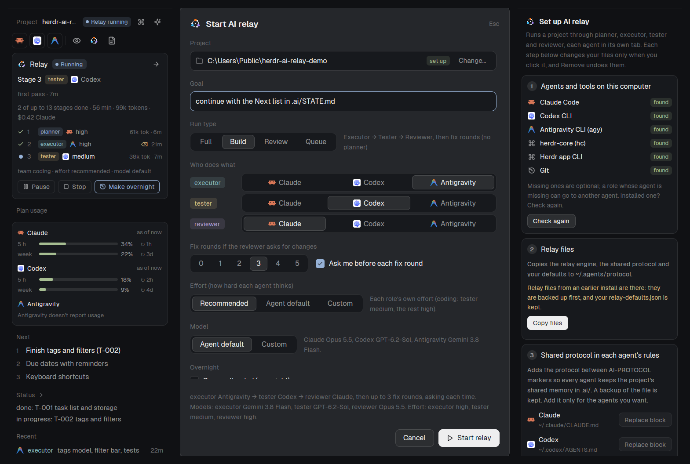

# AI Relay Kit

A right-hand panel, a dialog, a command list and a handoff viewer that run a project through a team of AI
agents (coding team: planner → executor → tester → reviewer), each in its own Herdr tab, and show the project's
shared `.ai/` memory live. The first time, the panel is a step-by-step "Set up AI relay" screen.

## What you see

- **Panel** (`ai-relay-kit`, docked right, 300 px; a 44 px rail under 160 px). Header row: "Project", the
  project's folder name, a state pill (Not set up / Idle / Agent active / Relay running / Paused), a ⌘ button
  (AI commands) and a ✦ button (setup). Body, scrolling: a row of 28 px icon buttons (Continue with Claude /
  Codex / Antigravity, review, relay, handoff); the relay card (relay icon, state pill, "Stage 3 · tester ·
  Codex", fix round, verdict pill, "Needs you" box when the relay asks something, totals line "3 of up to 13
  stages done · 1 h 12 min · 412k tokens", queue rows and stage rows with role pills in ansi4/6/3/5, Pause/Resume
  and Stop); "Plan usage" with 5 h and week bars for Claude and Codex (green, amber ≥70 %, red ≥90 %); "Next"
  (first five of STATE's Next), "Status" (two lines, expandable), "Recent" (last four LOG lines with agent
  icon and role), "Blockers" in the blocked color.
- **Setup screen** (same panel): five numbered cards on the background color with a 1 px border and 9 px
  radius: 1 Agents and tools (found pill in ansi2, or an amber "missing · install page ↗" chip), 2 Relay files,
  3 Shared protocol in each agent's rules (one row per agent with its file and an Add block button),
  4 The relay command (PATH), 5 Herdr + menu. Done (primary) and Remove… (danger, asks twice) at the bottom.
- **Start AI relay** dialog (600 × 820): Project (folder, set up/new pill, Change…), Goal input, Team (only with
  more than one team), Run type segments (Full, Build, Review, Queue) with a one-line description, Who does what
  (per role, three agent segments), Fix rounds 0–5 and "Ask me before each fix round", Effort (Recommended /
  Agent default / Custom per role; executor only High/XHigh/Max), Model (Agent default / Custom), a summary line,
  Cancel / Start relay.
- **AI commands** popup (520 wide, top): filter input, rows with icon, "AI: …" title and key.
- **Handoff viewer** pane: tabs Handoff · State · T-xxx · Decisions, the file as markdown.
- **Drawer** (optional floating block): relay icon, stage number and pulsing dot; slides out the stage line
  with Pause/Stop.

## How it behaves

- Panel follows the focused space: finds the nearest folder upward with `.ai/STATE.md`, watches `.ai/`, and
  re-reads every 10 s. A relay is live while `.ai/relay/status.json` has a heartbeat under 60 s old.
- Keys (in `keys.json`): Ctrl+Alt+R launcher, Ctrl+Alt+A commands, Ctrl+Alt+P focuses the panel (then 1/2/3,
  R, H, V, A, Esc), Ctrl+Alt+H handoff viewer.
- Setup: on start the panel runs `setup.ps1 -Action detect`; if the kit isn't installed it shows setup.
  Each button runs one action, then detects again. Nothing happens without a click.
- Start relay opens tab "AI Relay" running `powershell -File ~/.agents/protocol/ai-relay.ps1 -Folder … -Goal …
  -Stages … -Loop … -MaxRounds … -Effort … -Model … -Team …` in the project's space (or a new space).
- Pause/Stop write `.ai/relay/PAUSE` / `STOP` through `cmd`.
- The "Needs you" box and the card's arrow open the relay's own tab (`relayTerminal` in status.json, else the
  space's "AI Relay" tab). A stage that had leftovers stopped after it (`cleaned`) shows ⌫ in ansi3 and lists
  them in its tooltip. When status.json has `error`, the relay card shows a red "Stopped by an error: …" box
  (blocked color wash; click = relay tab).
- The dialog's "Run unattended (overnight)" box (ansi3 when on, never remembered) adds `-Overnight` and shows a
  warning line: no questions, all agent permissions skipped, own git branch, pre-flight in the AI Relay tab; below it
  "Run until" (A time + a time input | Until done) and, for Queue, "Cycles" (1/2/3/5/10/No limit), passed as
  `-Until` / `-MaxCycles`.
- Relay card while live: an ansi4 "Make overnight" button (or "Limits" on an overnight relay) opens the
  `ai-relay-kit-overnight` dialog (520 × 400: Run until, Cycles, a summary line, Cancel / Make overnight | Update
  limits), which runs `ai-relay.ps1 -MakeOvernight -Folder … -Until … -MaxCycles …`. An overnight relay shows an
  ansi4 pill "Overnight · until 07:00 · 1/3 cycles" with branch and limits in its tooltip.

## Built from

- Mods: `ai-relay-kit` (main.js, setup.js, lib.js, icons/, payload/), `ai-relay-kit-launcher`,
  `ai-relay-kit-commands`, `ai-relay-kit-handoff`, `ai-relay-kit-drawer`, `ai-relay-kit-overnight`; each has a
  copy of lib.js.
- `herdr`: spaces, panes, agents, focused, keys, layout, theme, settings, window, shared/setShared, readTextFile,
  watchFolder, exec, run (`tab.new`, `space.new`, `pane.split`, `pane.focus`, `mod.open`, `layout.show`,
  `layout.resize`), openOverlay via `mod.open`, closeOverlay, pickFolder, nextCommand, home, appHome, checking.
- Programs: `powershell` (setup.ps1, ai-relay.ps1), `hc send` (review request), `cmd` (control files),
  `rundll32 url.dll,FileProtocolHandler` (open an install page).
- Setup's install links (official pages, checked 2026-11-24): Claude Code `https://code.claude.com/docs/en/setup`,
  Codex CLI `https://github.com/openai/codex`, Antigravity CLI `https://antigravity.google/download`, Herdr app and
  herdr-core `https://herdr.dev/download/`, Git `https://git-scm.com/install/`. Setup only opens them; it never
  downloads or runs an installer.
- Engine options it relies on (relay-defaults.json): `codexApproveForMe` (Codex `--approve-for-me`) and
  `codexWindowsSandbox` (default `"mxc"` -> `-c windows.sandbox=mxc`; `"none"` leaves the flag out).
- Shipped program icons `icons/claude.svg`, `icons/codex.svg`, `icons/antigravity.svg`; the kit's own icons.

## Watch out

- Never pass null/undefined to `.child()`: the whole panel fails to render. Use `.when()` or an empty `div()`.
- Mods can't import across folders: edit `mods/ai-relay-kit/lib.js`, run `tools/sync-lib.ps1`.
- Herdr drops backslashes inside spaced arguments: the launcher passes paths with forward slashes.
- `herdr-app check` renders only the first state; `tests/check-setup-render.ps1` covers the setup screen and a
  project view with awkward relay data.
- Windows only (PowerShell engine). Usage windows can be missing from Claude's report: show a dash.
- `"place": "right"` docks the panel when Herdr starts with the folder present; a folder added while the
  first-run Welcome dialog is open docks on the next start.

## Done when

- `herdr-app check` passes for all six mods; `tests/check-setup-render.ps1` passes.
- `tests/test-setup.ps1` passes (the six mods copied into a temp Herdr home; install, protocol ×3, PATH,
  programs, remove against a temp user home). `tools/check-all.ps1` runs everything.
- In Herdr: the panel shows setup on a machine without `~/.agents/protocol/.ai-relay-kit.json`, every step
  turns to a green pill after its click, and Ctrl+Alt+R starts a relay that opens an "AI Relay" tab.
